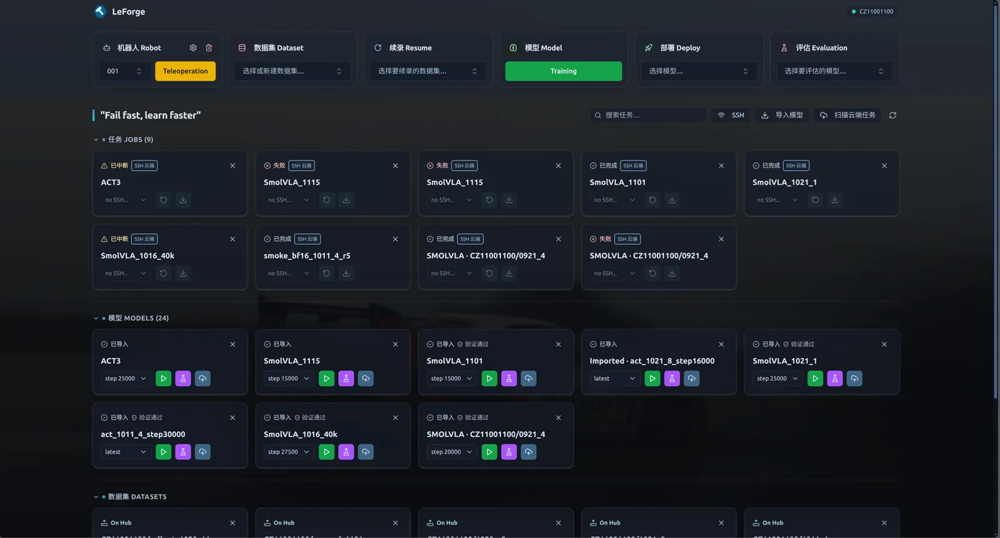
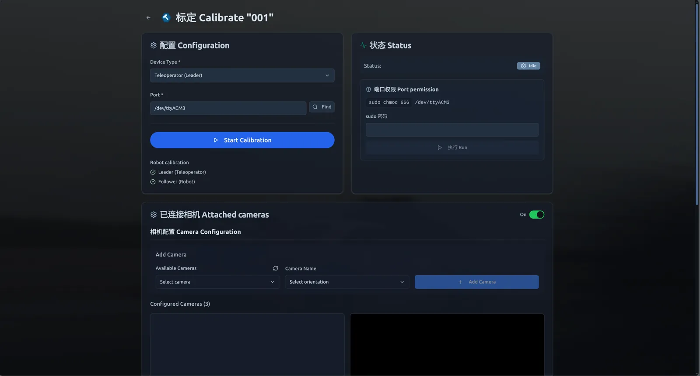
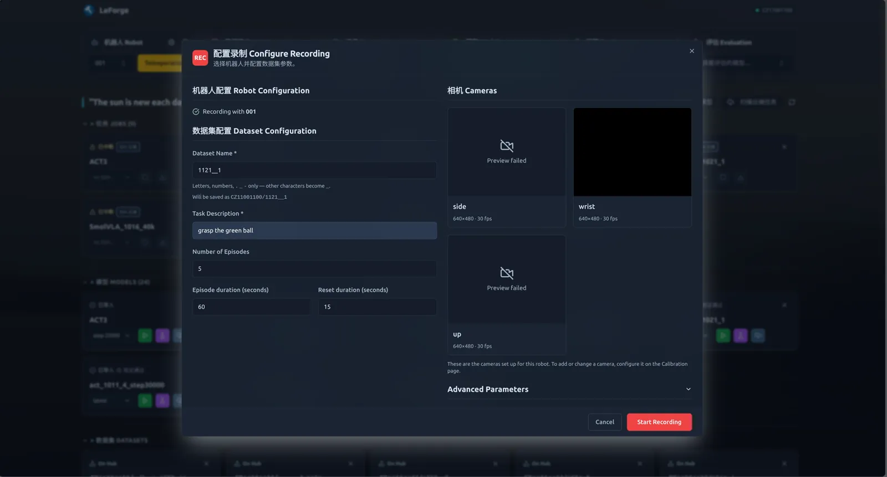
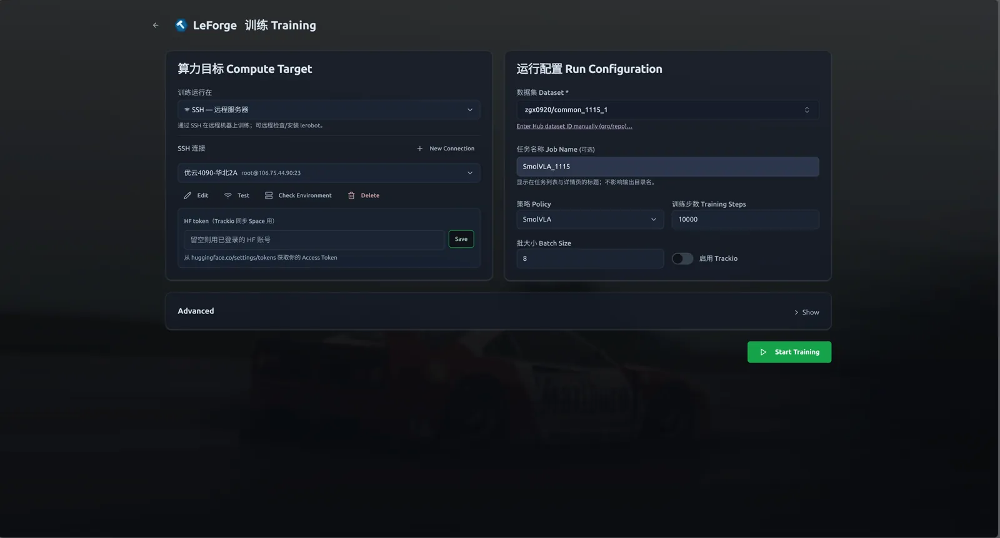
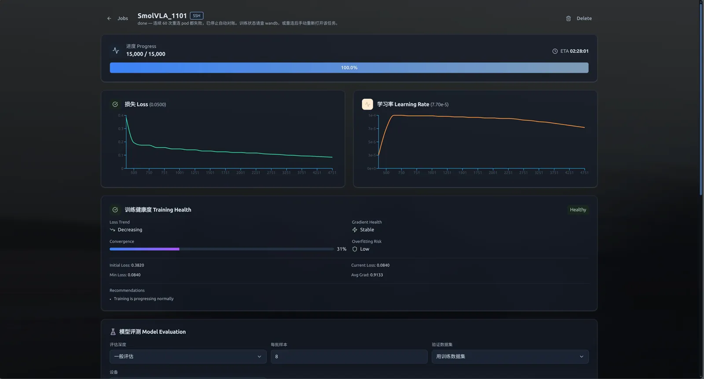
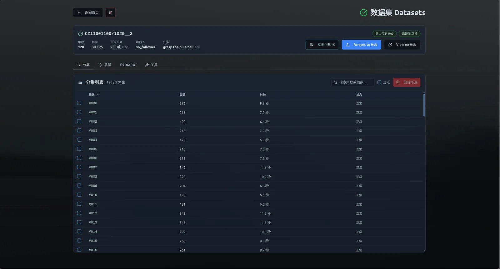
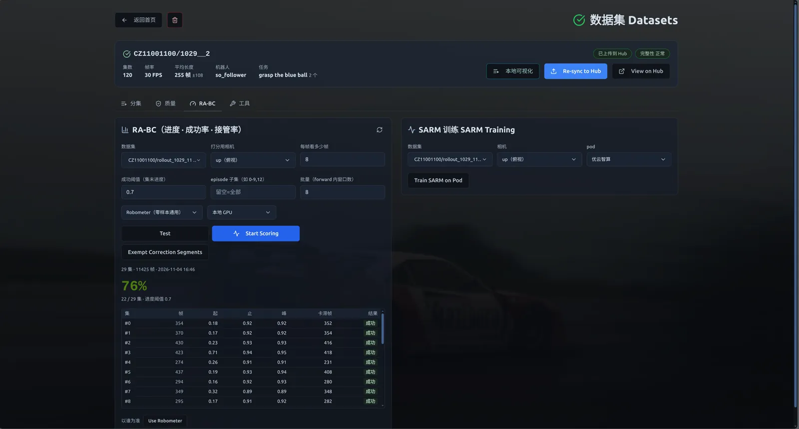
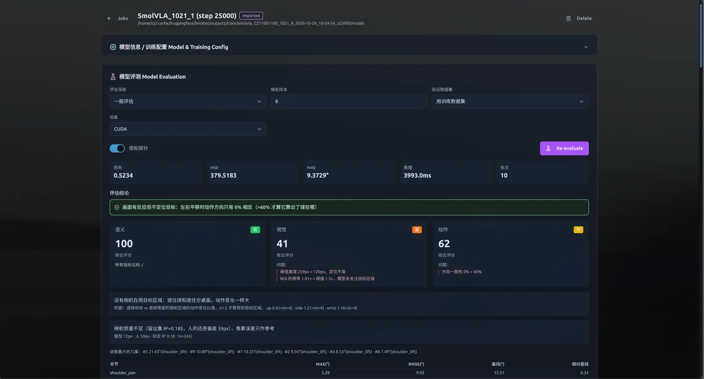
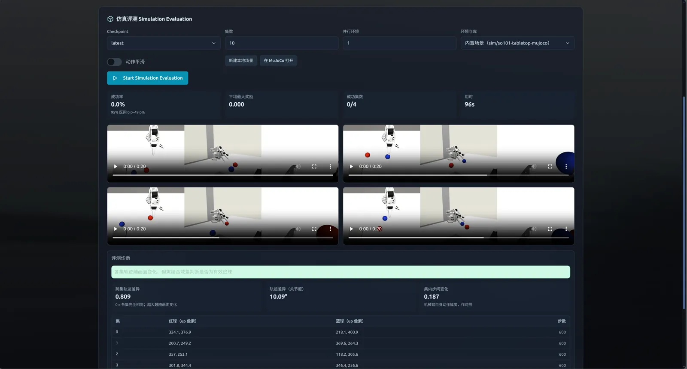
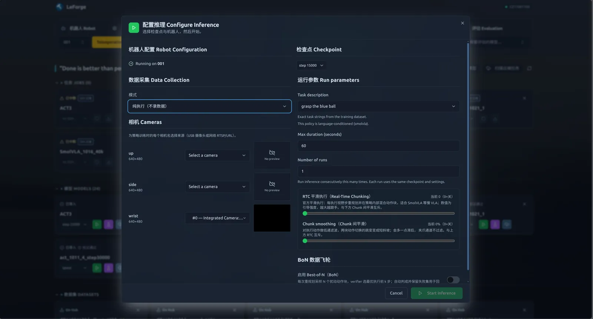

# LeForge

SO-100 / SO-101 机械臂的 LeRobot Web 工作台：在浏览器里完成标定、遥操作、数据采集与回放、训练、评估与仿真评测。

主要功能：leader 主臂遥操、键盘 IK 遥操、数据集管理（Hub 拉取 / HDF5、Zarr 导入导出）、本地与 SSH / HuggingFace 云训练、策略评估、MuJoCo 仿真评测、BoN 数据飞轮、相机曝光与增益调节。

## Linux

**一键安装**（Ubuntu 22.04+，装完运行 `leforge`，浏览器打开 http://localhost:8000）

```bash
curl -fsSL https://raw.githubusercontent.com/cz11001100/LeForge/main/install.sh | bash
```

**最小安装**

```bash
curl -fsSL https://raw.githubusercontent.com/cz11001100/LeForge/main/install.sh | bash -s -- --lite
```

**升级**（重跑安装命令拉最新代码；装完必须重启服务才生效）

```bash
curl -fsSL https://raw.githubusercontent.com/cz11001100/LeForge/main/install.sh | bash      # 轻量档加 -s -- --lite
leforge --stop && leforge        # 重启服务；浏览器再 Ctrl+Shift+R 硬刷新
```

## Windows

**一键安装**（Windows 10/11，无需 WSL2，PowerShell 里粘贴。代码落在 `%USERPROFILE%\LeForge`，装完运行 `%USERPROFILE%\LeForge\leforge-run.ps1`）

```powershell
powershell -ExecutionPolicy Bypass -NoProfile -Command "irm https://raw.githubusercontent.com/cz11001100/LeForge/main/install.ps1 | iex"
```

**最小安装**

```powershell
$env:LEFORGE_PROFILE="lite"; irm https://raw.githubusercontent.com/cz11001100/LeForge/main/install.ps1 | iex
```

**升级**（同步脚本、Python 依赖与前端产物；轻量档先执行 `$env:LEFORGE_PROFILE="lite"`）

```powershell
powershell -ExecutionPolicy Bypass -NoProfile -Command "irm https://raw.githubusercontent.com/cz11001100/LeForge/main/upgrade.ps1 | iex"
```

升级后重启服务才生效：关掉正在运行的 leforge 窗口，重新运行 `%USERPROFILE%\LeForge\leforge-run.ps1`，浏览器 Ctrl+Shift+R 硬刷新。

Windows 不安装 `placo`，键盘 IK 遥操（keyboard_ee）不可用，接 leader 主臂遥操正常。

## 入门教程

装完运行 `leforge`，浏览器打开 http://localhost:8000。主页是总入口，六个卡片对应一条完整流程，按顺序走一遍即可：



1. **连接与标定** — 主页「机器人 Robot」选设备（如 001）→ Teleoperation 标定 Leader 与 Follower；在「硬件连接」页配好 side / wrist / up 三相机。

   

2. **采集数据** — 「数据集 Dataset」→ 配置录制：填数据集名、任务描述（如 `grasp the green ball`）、回合数与时长 → Start Recording，遥操采一批演示。

   

3. **训练** — 「模型 Model」→ Training：选算力（本机或 SSH 云端 GPU）+ 数据集 + 策略（SmolVLA / ACT 等）+ 步数、批大小 → Start Training；任务详情页看进度、损失曲线与训练健康度。

   

   

4. **打分与数据飞轮** — 数据集详情页「RA-BC」标签：用 Robometer / SARM 给 rollout 打进度与成功率、产出 RA-BC 权重回灌续训；SARM 进度头可在 pod 上直接训。

   

   

5. **评估** — 「评估 Evaluation」：模型评测给出开环误差与语义 / 视觉 / 动作三维评分；仿真评测在 MuJoCo / EnvHub 跑闭环成功率并录三视角视频。

   

   

6. **部署** — 「部署 Deploy」：选 checkpoint + 相机 + 任务 + RTC / Chunk 平滑（可开 BoN）→ Start Inference，纯执行或边跑边纠正采集。

   

另有「续录 Resume」补采、「导入模型」拉外部权重、SSH 云端任务扫描。
